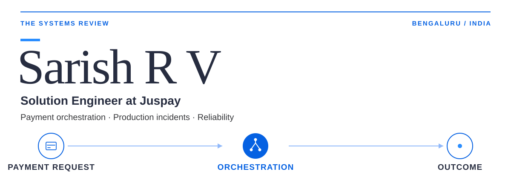
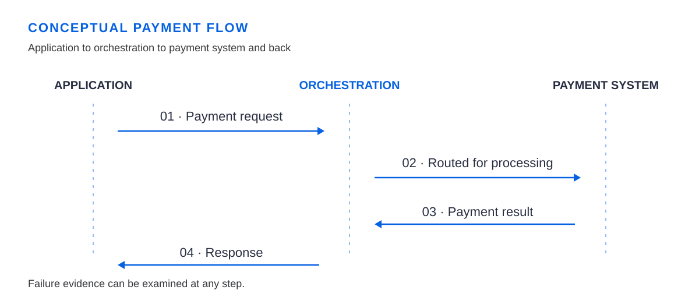
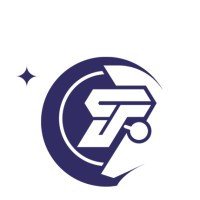

<picture>
  <source media="(max-width: 640px)" srcset="./assets/profile-cover-mobile.svg">
  
</picture>

**Solution Engineer at Juspay · Bengaluru**  
Payment orchestration · Production incidents · Reliability

## What I work on

**Juspay · Solution Engineer**  
**Jul 2025 — Present · Bengaluru**

- **Payment orchestration:** Follow payment requests across connected systems.
- **Production incidents:** Investigate system behavior, evidence, and technical failures.
- **System reliability:** Understand dependencies and the conditions that support dependable payment infrastructure.

## Payment flow

<picture>
  <source media="(max-width: 640px)" srcset="./assets/payment-flow-mobile.svg">
  
</picture>

A general payment sequence—not Juspay's internal architecture.

## Technologies

**Payment engineering**  
Payment orchestration · Payment infrastructure · Incident analysis · Reliability · Troubleshooting

**Backend**

  
  
  &nbsp; REST APIs · JWT

**Frontend**

  
  
  
  
  
  
  

**Data**

  
  
  

**Cloud and tools**

  <picture>
    <source media="(prefers-color-scheme: dark)" srcset="./assets/icons/aws-dark.svg">
    
  </picture>
  
  
  
  
  
  

**Core foundations**  
Data structures · Algorithms · Problem-solving

## Earlier experience

 **Ticket Buddy · Full-stack Developer**  
Oct 2024 — Jan 2025  
MERN applications · Backend services · UI improvements · AWS · GCP

 **Tecnonauts Technology Services · Full-stack Developer**  
Jun — Jul 2024  
React interfaces · Backend API integrations · Node.js · PostgreSQL · Azure

<strong>Earlier roles · 2023–2024</strong>

 **Shocals Enterprises · Feb — Mar 2024**  
Angular · Ionic · JWT authentication · PostgreSQL

 **NinjaBytes · Dec 2023 — Jan 2024**  
Portfolio websites · REST APIs · React · Node.js

 **TechnoHacks EduTech · Jun — Jul 2023**  
Educational web applications · Frontend development · Backend integrations

## Reference shelf

  
  <strong>650+ problems solved</strong> · <a href="https://leetcode.com/u/sarishrv/">LeetCode ↗</a> 
   GitHub Foundations 
   Microsoft Azure Fundamentals (AZ-900) 
   IBM Full Stack Software Developer — Coursera

**Education**  
B.Tech · Information Technology  
St. Joseph's College of Engineering · 2021–2025

## GitHub activity

**On GitHub since September 2023** · **[YOLO achievement ↗](https://github.com/rvsarish?achievement=yolo&tab=achievements)**

  <a href="https://github.com/rvsarish">
    <picture>
      <source media="(prefers-color-scheme: dark)" srcset="https://github-profile-summary-cards.vercel.app/api/cards/stats?username=rvsarish&amp;theme=github_dark">
      
    </picture>
  </a>
   
  
  &nbsp;
  

## Find me elsewhere

  <a href="https://www.linkedin.com/in/sarishrv/"> <strong>LinkedIn ↗</strong></a>
  &nbsp; &nbsp;
  <a href="https://github.com/rvsarish"> <strong>GitHub ↗</strong></a>

